<h1 align="center">CanvasAnvil</h1>

<p align="center">
  <strong>AI-powered multi-canvas creation for diagrams, interior design, presentations and images.</strong>
</p>

<p align="center">
  
  
  
  
  
  
  
</p>

<p align="center">
  <a href="#creative-canvases">Canvases</a> |
  <a href="#ppt-canvas">PPT Showcase</a> |
  <a href="#video-tutorial">Video Tutorial</a> |
  <a href="#skills">Skills</a> |
  <a href="#quick-start">Quick Start</a> |
  <a href="#recent-updates">Recent Updates</a> |
  <a href="README.zh-CN.md">Chinese</a>
</p>

https://github.com/user-attachments/assets/582c70ae-38df-4949-913c-c3f4369a7c8c

<p align="center">
  <strong>⭐ If CanvasAnvil helps your workflow, please star the repo and fork it for your own canvas experiments.</strong>
</p>

> CanvasAnvil brings diagramming, interior design, presentation production and free-form image work into one workspace, in Chinese or English.

## 🔷 Diagram Canvas

Turn structured prompts into clear diagrams for research, systems, delivery plans, and teaching maps, then keep refining layout, labels, and node relationships in one place.

### Showcase

<table>
  <tr>
    <td width="50%" align="center">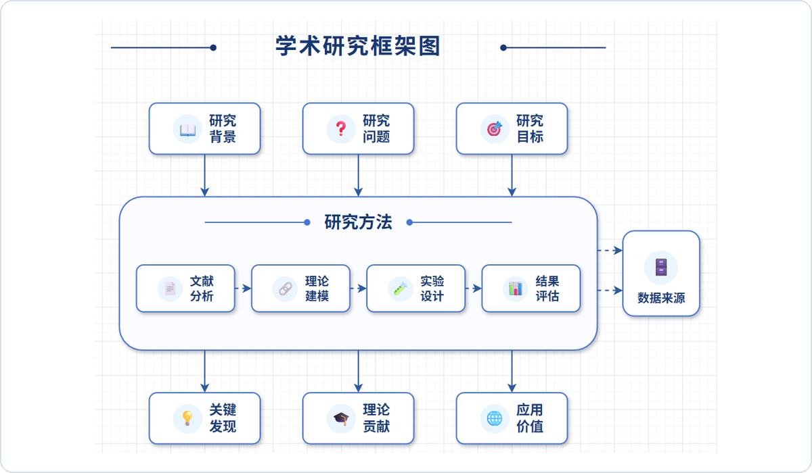<br/><strong>Academic Research Framework</strong></td>
    <td width="50%" align="center"><br/><strong>Intelligent Q&A System Architecture</strong></td>
  </tr>
  <tr>
    <td width="50%" align="center"><br/><strong>Project Implementation Roadmap</strong></td>
    <td width="50%" align="center">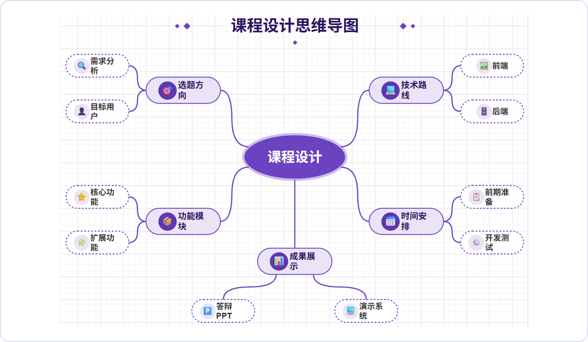<br/><strong>Course Design Mind Map</strong></td>
  </tr>
</table>

## 🏠 Interior Design Canvas

Describe the home you want, settle the plan with clickable decisions, and get an editable floorplan in a full house designer (2D, 3D, furniture, MEP, ceilings), checked and audited, with the quote, drawing set, DXF, colour plan and renders exported from it. You can also start from your own floorplan.

### Showcase

<table>
  <tr>
    <td colspan="2" align="center"><a href="public/examples/readme-previews/cad/split-view.png">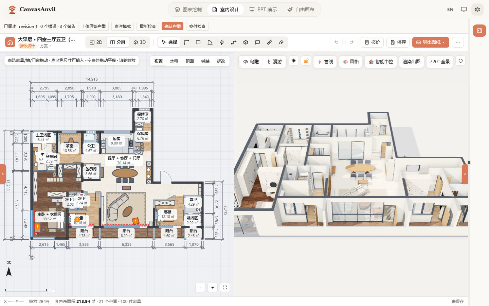</a><br/><strong>2D + 3D Split View</strong></td>
  </tr>
  <tr>
    <td width="50%" align="center"><a href="public/examples/readme-previews/cad/floorplan-furniture.png"></a><br/><strong>Editable Floorplan & Furniture</strong></td>
    <td width="50%" align="center"><a href="public/examples/readme-previews/cad/walkthrough.png"></a><br/><strong>3D Walkthrough</strong></td>
  </tr>
  <tr>
    <td width="50%" align="center"><a href="public/examples/readme-previews/cad/mep-routing.png">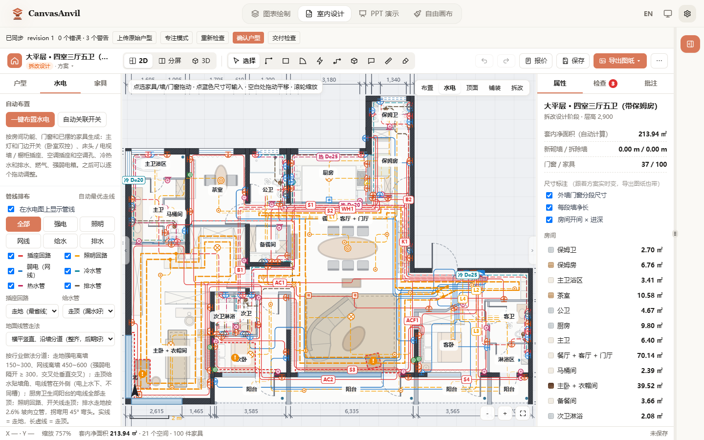</a><br/><strong>MEP Layout & Routing</strong></td>
    <td width="50%" align="center"><a href="public/examples/readme-previews/cad/ceiling-lighting.png"></a><br/><strong>Ceiling & Lighting Plan</strong></td>
  </tr>
  <tr>
    <td width="50%" align="center"><a href="public/examples/readme-previews/cad/quantity-quote.png">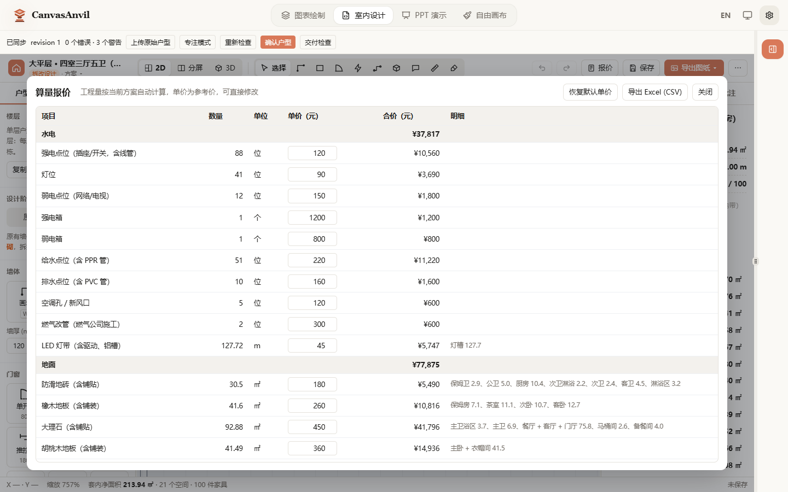</a><br/><strong>Quantity Takeoff & Quote</strong></td>
    <td width="50%" align="center"><a href="public/examples/readme-previews/cad/drawing-exports.png">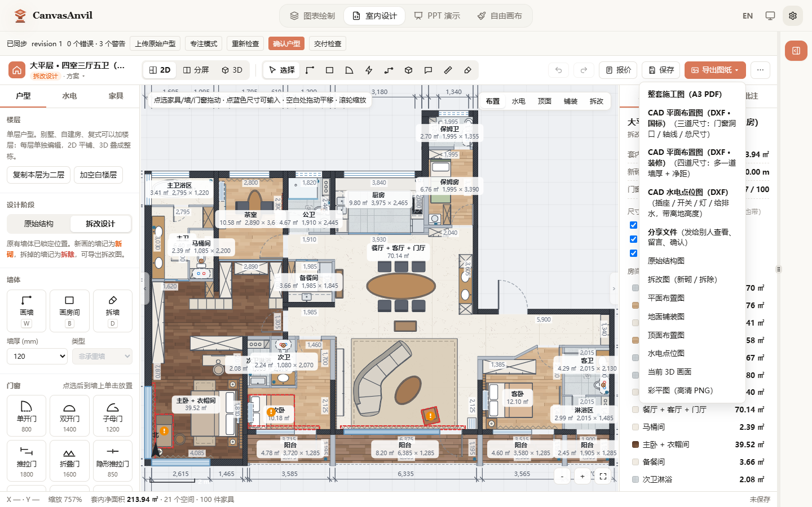</a><br/><strong>Construction Drawing Exports</strong></td>
  </tr>
</table>

<a id="ppt-canvas"></a>

## 📑 PPT Canvas

Generate full presentations through a controlled pipeline: outline first, visual production second, then export as PDF or image-based PPT. The deck template sets the style and colour palette; each slide gets a layout of its own.

### Showcase

<table>
  <tr>
    <td width="50%" align="center" valign="top">
      
      <strong>AI Content Creation Workflow</strong>
    </td>
    <td width="50%" align="center" valign="top">
      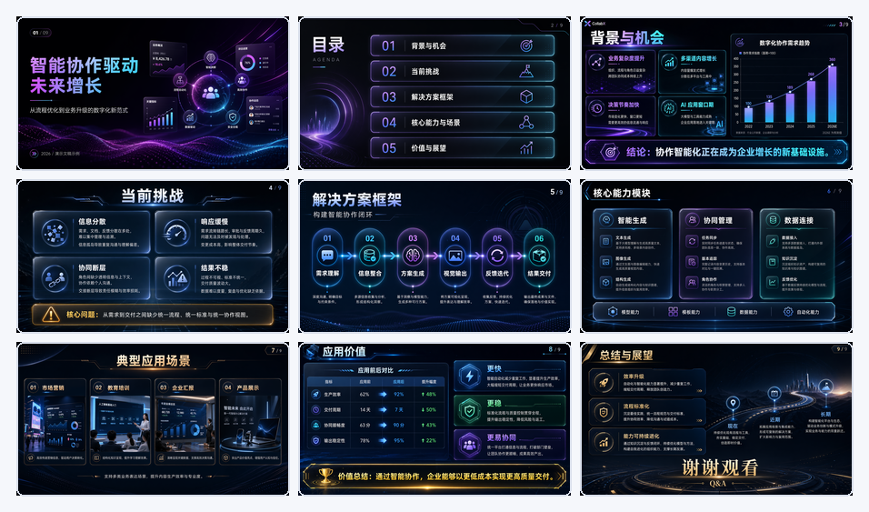
      <strong>Intelligent Collaboration Growth</strong>
    </td>
  </tr>
  <tr>
    <td width="50%" align="center" valign="top">
      
      <strong>AI-Driven Business Innovation</strong>
    </td>
    <td width="50%" align="center" valign="top">
      
      <strong>Low-Carbon Smart Campus Transformation</strong>
    </td>
  </tr>
</table>

## 🖌️ Free Canvas

A whiteboard for images: describe a picture in one sentence and it lands on the board. Circle what to change, write a note beside it, press the wand, and a new version appears next to the original. Every version is kept, and the version strip shows what each one changed and when.

### Showcase

<table>
  <tr>
    <td width="50%" align="center"><br/><strong>An Image from One Sentence</strong></td>
    <td width="50%" align="center"><br/><strong>Mark It Up on the Board</strong></td>
  </tr>
  <tr>
    <td width="50%" align="center">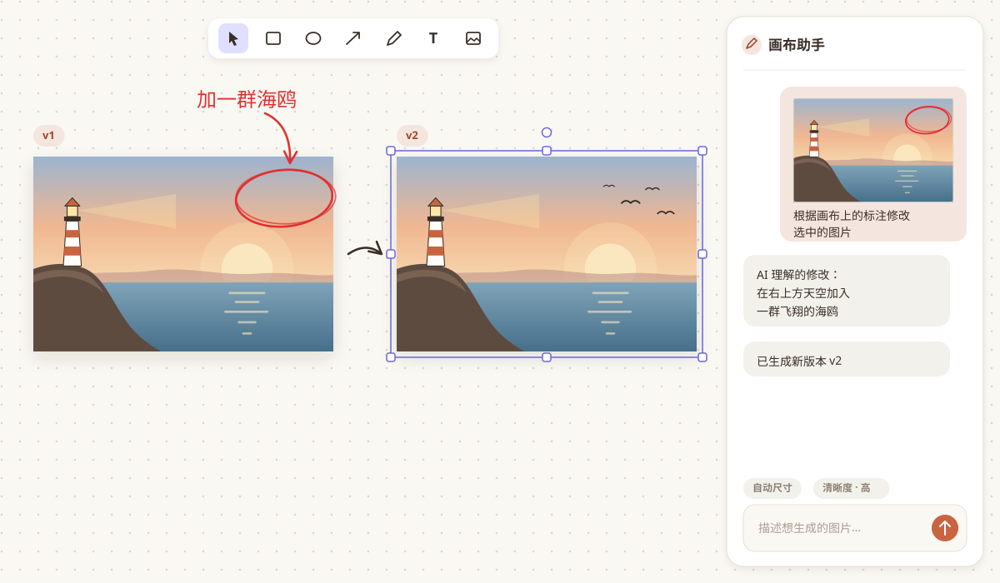<br/><strong>A New Version from the Marks</strong></td>
    <td width="50%" align="center">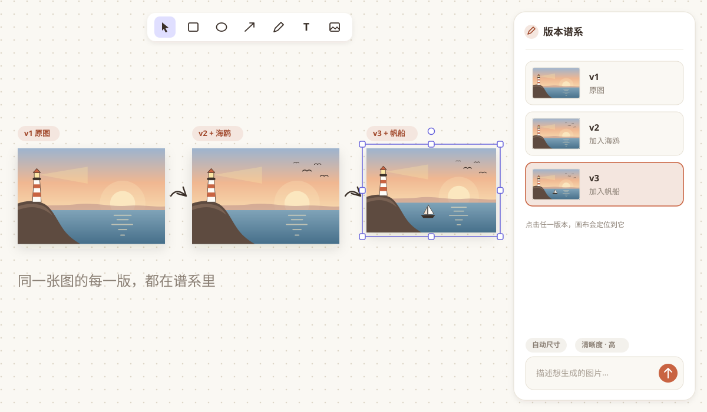<br/><strong>Compare the Versions</strong></td>
  </tr>
</table>

<a id="creative-canvases"></a>

## 🎨 Creative Canvases

| Workspace | Focus | Typical output |
| --- | --- | --- |
| `Diagram` | structured diagram generation and partial editing | flowcharts, architecture diagrams, logic diagrams |
| `Interior Design` | interior planning, drawing coordination, and delivery packaging | concept boards, 2D drawings, render briefs, material lists |
| `PPT` | structured presentation generation and export | presentations, pitch decks, report slides |
| `Free Canvas` | text-to-image and edit-by-annotation on a whiteboard | posters, illustrations, revised versions of an image |

## 🌐 Online Access

Current online access URL:

- 🔗 CanvasAnvil: [https://canvasanvil.codingfgd.asia](https://canvasanvil.codingfgd.asia)

## Video Tutorial

One walkthrough per canvas on Bilibili (narrated in Chinese). In the app, the **Tutorials** button at the top of the home page plays them in place.

<table>
  <tr>
    <td width="50%" align="center"><a href="https://www.bilibili.com/video/BV1wyxs66EEd">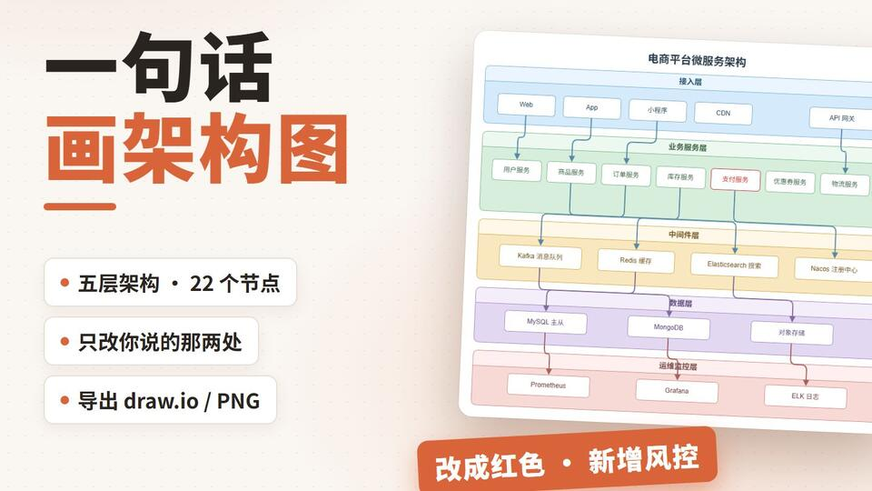</a><br/><strong>🔷 Diagram</strong> · <a href="https://www.bilibili.com/video/BV1wyxs66EEd">A whole architecture diagram from one sentence, and edits that touch only what you name</a></td>
    <td width="50%" align="center"><a href="https://www.bilibili.com/video/BV1ryxs6zEtN">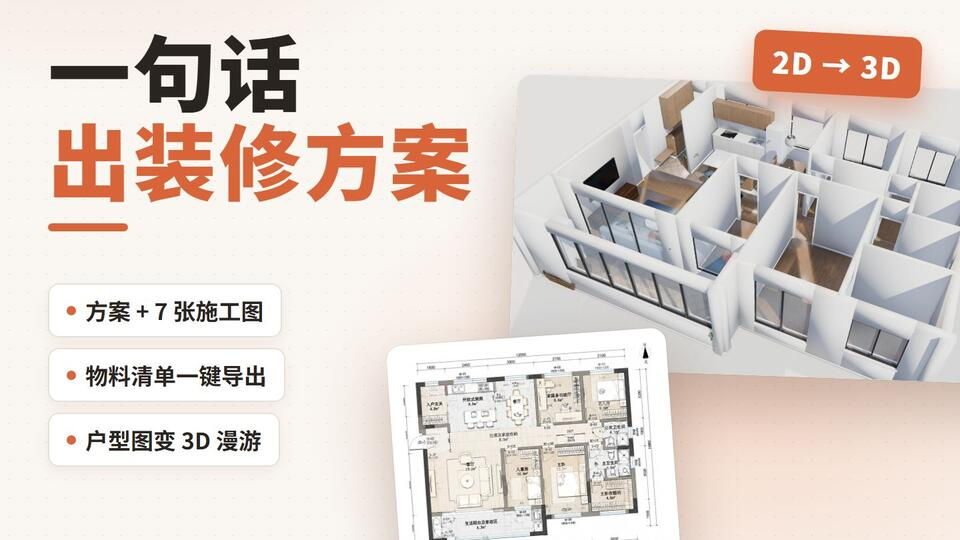</a><br/><strong>🏠 Interior Design</strong> · <a href="https://www.bilibili.com/video/BV1ryxs6zEtN">A full set of renovation drawings from one request, plus a 3D walkthrough</a></td>
  </tr>
  <tr>
    <td width="50%" align="center"><a href="https://www.bilibili.com/video/BV1oGxs6hEf6"></a><br/><strong>📑 PPT</strong> · <a href="https://www.bilibili.com/video/BV1oGxs6hEf6">An 8-slide deck from one sentence, with 200+ templates to choose from</a></td>
    <td width="50%" align="center"><a href="https://www.bilibili.com/video/BV17Gxs6aETm">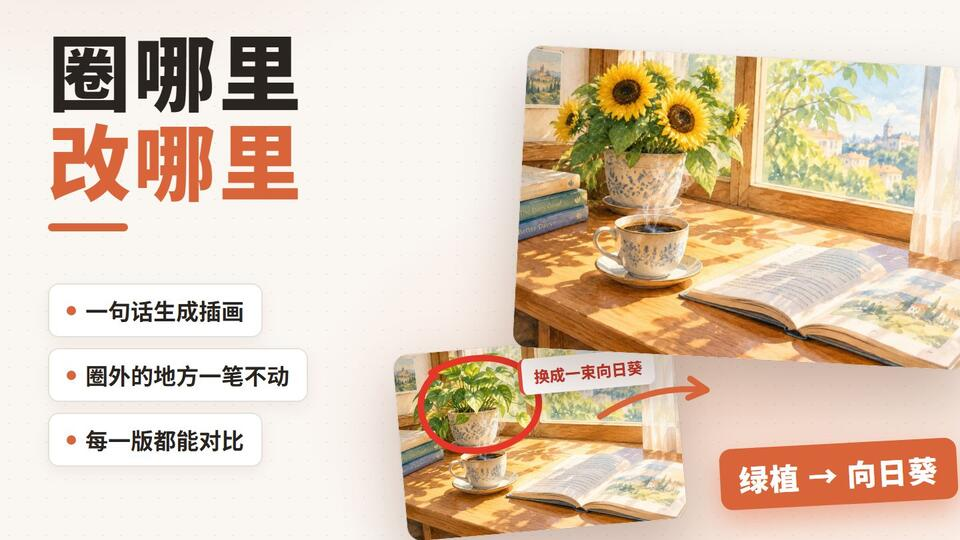</a><br/><strong>🖌️ Free Canvas</strong> · <a href="https://www.bilibili.com/video/BV17Gxs6aETm">Circle a spot and only that changes; the rest of the image stays put</a></td>
  </tr>
</table>

<a id="skills"></a>

## 🧰 Skills

CanvasAnvil includes dedicated local skills for each canvas so workflows stay opinionated, repeatable, and easier to maintain.

- `diagram-skill` · Diagram generation and packaging
  Opens the existing draw.io editor inside Codex. Chat-driven XML updates, manual edits and drawio/SVG/PNG exports synchronize through MCP. State lives under the project’s `diagram/` directory. The online draw.io editor requires network access.
- `cad-skill` · Interior-delivery workflow
  Opens the existing house designer inside Codex, with chat-driven designs, operations and spec patches, synchronized manual edits, checks and exports. State lives under `cad/`. The existing offline reconstruction and delivery scripts remain available.
- `ppt-skill` · Full presentation production
  The website's flow: a bundled template library, idea / outline / beautify modes, outline review with the user before anything is drawn, all slides drawn concurrently with retries, single-slide edits, and PDF, image PPTX or editable PPTX export. Prompts and templates are synced from the website with `node scripts/sync-ppt-skill.mjs`.
- `canvas-skill` · Image creation on a local whiteboard
  A native Codex canvas plugin reusing the website's Excalidraw board, annotation compositor, image placement and version strip. Give instructions directly in the Codex conversation. Codex captures selected images and annotations through MCP, then uses the host image tool and inserts results. Data lives in the project's `canvas/` directory.
  Install straight from GitHub, no clone needed:

  ```bash
  codex plugin marketplace add CodingFeng101/CanvasAnvil --ref main
  codex plugin add canvasanvil-canvas@canvasanvil
  ```

  Then restart Codex and invoke `$canvas-skill`, `$diagram-skill` or `$cad-skill`. Node 20+ is required. The release includes the MCP and widget bundles with no runtime npm installation. If you installed earlier from the `canvasanvil-local` marketplace, add the marketplace again with the first command, since its name changed. You can also copy any `skill/<name>` folder into a project and use it on its own.

All skills use the host text model by default. Only image generation requires explicit provider configuration.
Editable PPTX export uses the host model too: the agent rebuilds the slides step by step following `skill/ppt-skill/references/editable-pptx-workflow.md`, with the scripts in the skill's `editable/` folder; its previews use PowerPoint on Windows and LibreOffice elsewhere, plus the Python packages in `editable/requirements.txt`.

<a id="quick-start"></a>

## 🚀 Quick Start

1. Install dependencies

```bash
npm install
```

2. Start local development

```bash
npm run dev
```

Default URL: `http://127.0.0.1:8001`

CanvasAnvil deploys as a single service. See [deploy/README.md](deploy/README.md) for detailed deployment configuration.

3. Run type checks

```bash
npm run check
```

4. Build for production

```bash
npm run build
```

## 🧪 Common Commands

- `npm run dev`: start the app on `8001`
- `npm run check`: run TypeScript checks
- `npm run lint`: run ESLint
- `npm test`: run the test suite
- `npm run build`: build the production bundle

## 📝 Development Notes

- Every model call uses the OpenAI HTTP protocol. To use another vendor, point the base URL in Settings at their OpenAI-compatible endpoint — there is no provider list to pick from.
- AI configuration is read from local app settings; the text and image channels are configured separately.
- Local development depends on the API service for `/api/chat` and `/api/ppt-ai`.
- After changing local API route wiring in `vite.config.ts`, restart the dev server.
- `server/**` uses relative imports: `vite.config.ts` imports the dev middleware so `npm run dev` serves the API in-process, and Vite loads its own config through plain Node, which does not know the `@/` alias.
- Set `PROMPT_LOG_DIR` to write assembled prompts to disk; it is off by default because the log contains the user's content.

## 📚 Docs

- Architecture overview: [docs/architecture.md](docs/architecture.md)
- Deployment guide: [deploy/README.md](deploy/README.md)

<a id="recent-updates"></a>

## 🗓️ Recent updates

### 2026-11-18

**✨ New**

- **My works: keep several works per canvas**
  - A new **My works** button in the header lists everything you have saved, with tabs for All / Diagram / Interior Design / PPT / Free Canvas. Open, rename, duplicate or delete; opening a work of another canvas switches to it.
  - Every canvas gets a **Save** button in the toolbar under its chat input. Name the work the first time and it appears in My works.
  - **Saved when you press Save**: what is on the canvas is still kept in the browser all the time, so a reload loses nothing, but the version in My works changes only when you press Save. After further edits the Save button shows a dot.
  - Leaving a work with unsaved changes asks Save / Don't save / Cancel; Don't save takes it back to the last saved version. A draft that was never saved is simply dropped.
  - Clearing the chat keeps a saved work in My works and opens a new blank one.
  - What you had before upgrading becomes your first work; the old data is left in place.

**⚡ Improvements**

- **The Diagram canvas keeps its chat and diagram in IndexedDB**, so long chats no longer fail to save when localStorage is full. Old data is copied over on first open and kept; replies being generated are saved every 3 seconds.
- **draw.io falls back to a mirror**: if the default address has not loaded in 8 seconds, the GitHub Pages mirror is used; if neither loads, a message with a Retry button appears. A draw.io address you configured yourself is used on its own.
- **No clone needed to install the plugin**: the README now adds the marketplace straight from GitHub (`codex plugin marketplace add CodingFeng101/CanvasAnvil`). The marketplace is renamed `canvasanvil`; if you added it as `canvasanvil-local`, add it again.

### 2026-11-13

**🐛 Fixes**

- **Diagram: "Drawing the diagram" kept spinning after the diagram was drawn, and edits failed**
  - After a dependency upgrade the AI SDK expects messages with `parts`; the diagram chat still sent the old format, so tool results never landed and the step stayed "running". That unanswered tool call then made the next request (an edit, for example) fail at the model API.
  - User messages use the new format; older chats are converted when opened, and steps stuck as running are closed, so they can be edited again.
- **Interior Design: picked decisions seemed to be ignored**
  - After you confirm the plan, its decisions show what you picked, along with the note you wrote under the options.
  - The floorplan request now lists your picks as the final decisions, and the model is told they override the rooms and must-have furniture the plan wrote for its own recommendation (central air conditioning means no wall units, for example).
- **Interior Design: `Designer unavailable` while generating, fixed only by generating again**
  - When a repair round reloaded the designer, the checks that followed still used the removed one. Every step now uses the current designer.
- **Interior Design: the floorplan step kept spinning after switching canvases or reloading**
  - Leaving the canvas stops the run, but the chat still showed it as running. It now shows as interrupted, with a button to generate again (your picks are kept).

**⚡ Improvements**

- The Interior Design canvas fills its area like the other canvases, with no margin or frame around it.
- The duplicate export buttons above the designer are gone; the quote, drawings, DXF, colour plan and renders come from the designer's own Quote and Export drawings at the top right.
- The README has its promo video back, and the links in its top navigation jump to their sections again.

### 2026-11-08

**✨ New**

- **The Interior Design canvas is rebuilt around an editable house designer**
  - The canvas now holds a full interactive house designer: 2D plan, 3D bird's-eye view and walk-through, furniture, MEP, ceilings, floor finishes, demolition layers, quote and drawing set, in the site's own theme. Every floorplan the AI makes opens there, and you can drag, edit and keep designing by hand.
  - **Plan first**: describe what you need and the AI writes a design plan (rooms, areas, orientation, zoning, entry). It streams readably in the chat as a chain of steps, and the floorplan is drawn only after you confirm the plan.
  - **Decisions as clickable options**: the plan lists everything there is to decide, grouped as layout / finishes / equipment / appliances / smart home / wiring: kitchen type and counter shape, floors per room, wall colours, skirting, ceilings, doors and windows, air conditioning, fresh air, heating, hot water, smart toilet, smart lighting and curtains, socket count, network points, where the panel and network box go, bedside USB, floor sockets. Each comes with a recommendation already picked; click to change any of them and confirm at the bottom of the plan, with nothing to type again.
  - **The model describes, the program draws**: the AI only writes the layout (a grid, rooms, doors, windows, furniture by intent, finishes) and a program computes walls, openings and furniture positions. Furniture that does not fit is shrunk or swapped for a smaller model, and every adjustment is listed.
  - **Finished for you**: furniture pushed slightly into walls or curtains is moved clear, MEP points are laid out in one go, then your wiring choices are applied (more sockets, network points, boxes by the entry door, floor sockets under the dining or coffee table, bedside USB).
  - **Room-by-room MEP audit**: lights, switches, sockets, which switch controls which light, mounting heights, switches on the handle side of doors, double control in bedrooms, the hood socket and gas alarm in the kitchen, splash-proof sockets in bathrooms, both boxes present. Problems are listed in the chat and in a collapsible list under it.
  - **Start from your own floorplan**: upload a photo, screenshot, PDF or DXF; walls and openings are recognized, the original is kept as an underlay, and the AI names the rooms and furnishes them.
  - **Change it by chat**: "make the master bedroom bigger", "add a window to the balcony". The AI reads the recent conversation and says what it changed, or why it changed nothing.
  - **Version history**: the history button under the chat shows every floorplan version as a thumbnail (AI, manual edit, recognized); restore any of them, and the restore can be undone the same way.
  - **Delivery from the designer itself**: quote, A3 drawing-set PDF, DXF (layout, MEP, demolition), colour plan and 3D renders.

- **`cad-skill` follows the same flow and runs on its own**
  - Copy the folder into any project. From an existing floor plan it builds the designer page; from a brief it settles the plan and decisions with you first (with the host's option picker when it has one), then lays out and draws the floorplan.
  - It then finishes the design without help: furniture nudged clear, MEP laid out, wiring choices applied, checks and the MEP audit run, and the quote CSV, drawing-set PDF, DXF, colour plan and 3D render exported.
  - It hands over `<name>-装修设计器.html`: the whole designer as one offline file with your design inside, opened in your browser. Double-click it to open again; edits made there are kept in that browser.
  - Before delivery it runs a full-feature acceptance pass over the page.
  - It uses the Chrome or Edge already on your machine, so no browser is downloaded: run `npm run setup` once in the skill folder. No API key or image model is needed.

**⚡ Improved**

- The floorplan is generated as a stream; output the model cut off midway is continued instead of failing, slipped JSON brackets are repaired, a failed step retries from where it stopped, and failures are shown in that step.
- Streamed AI calls log the time to the first token and the total time.

**🐛 Fixed**

- Switching away from the designer no longer crashes the workspace.
- A design survives a runtime error in the designer.
- Renaming a room replaces its label instead of stacking a second one on top.

**📌 Notes**

- Removed: the analysis boards, the AI material list, AI-drawn renders and the old SVG drawing flow. Every drawing now comes from the designer.
- Floorplan upload runs the designer's recognition scripts on the server (`server/recognizer/recognize.py`, using `skill/cad-skill/designer/scripts`); it needs Python with `pip install -r server/recognizer/requirements.txt` (or `PYTHON` pointing at one). Without it the upload button stays hidden. The Docker image includes it.
- The CAD "Delivery check" button runs the designer's acceptance (`skill/cad-skill/designer/scripts/qa.mjs --lite --quick`, then `qa_files.py`) on the server; it needs Chrome / Edge / Chromium there (or `CHROME_PATH`) and Python with the recognizer's requirements, and stays hidden without a browser. The Docker image includes Chromium.
- The MEP audit reports problems but does not move points; adjust them under MEP in the designer.
- In `cad-skill`, starting from an existing floor plan needs Python with `numpy pillow opencv-python pymupdf ezdxf pypdf`; designing from a brief needs only Node 18+.

## ⚖️ License

CanvasAnvil is released under the MIT License.
See [LICENSE](LICENSE) for the full license text.

## 💌 Contact

- `3524962421@qq.com`

## ⭐ Star History

[](https://star-history.com/#CodingFeng101/CanvasAnvil&Date)
