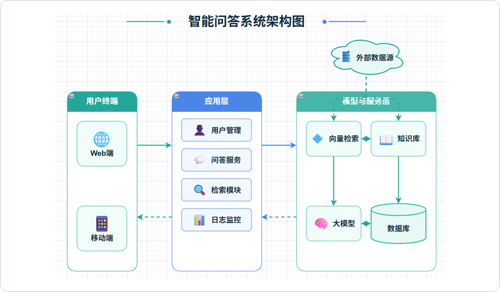
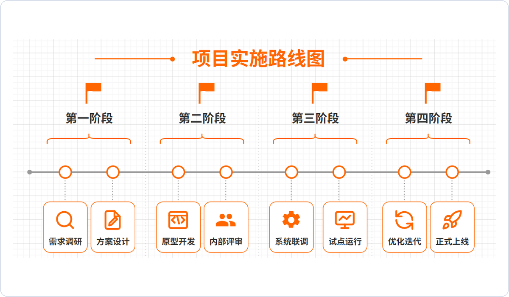
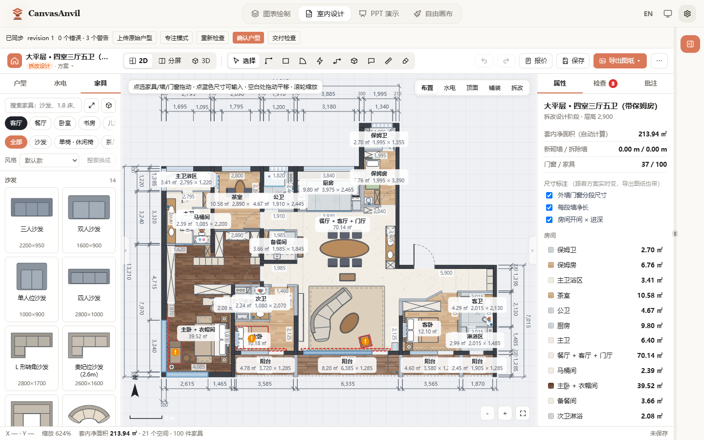
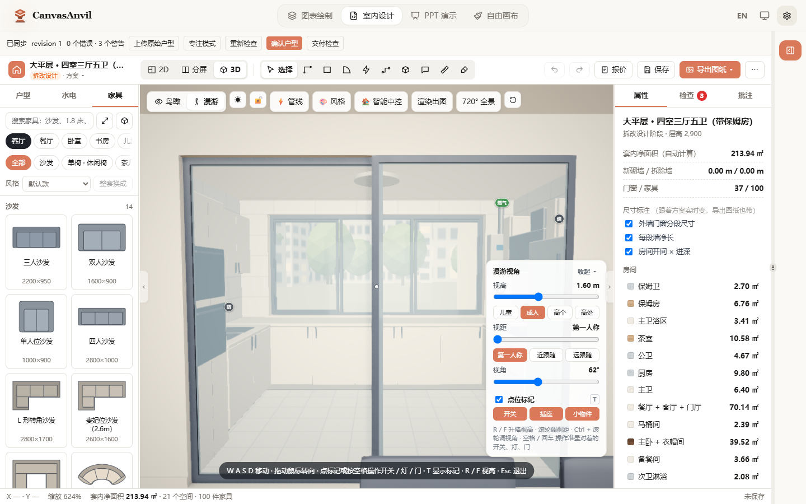
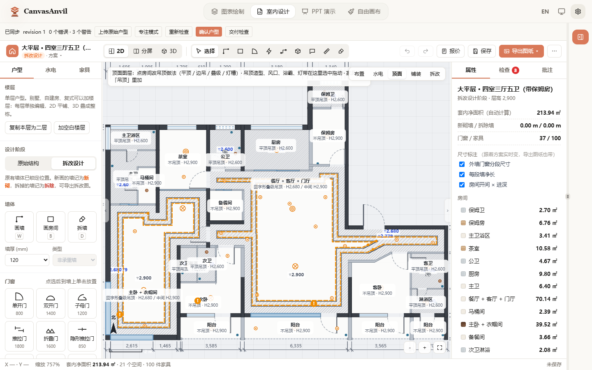
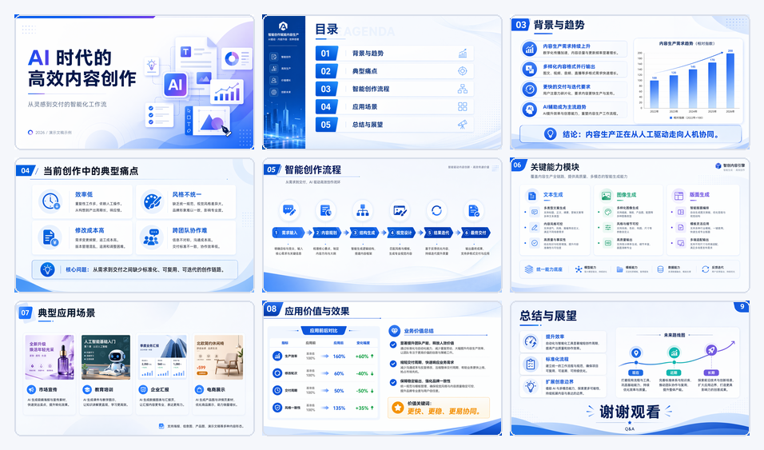
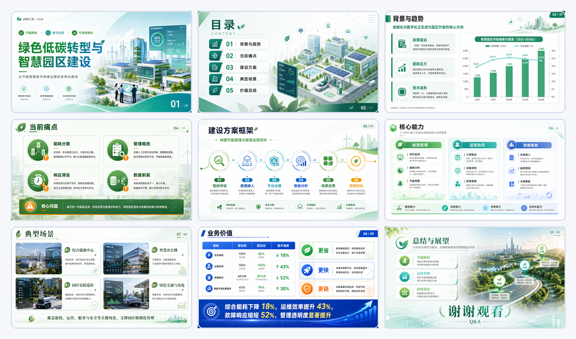
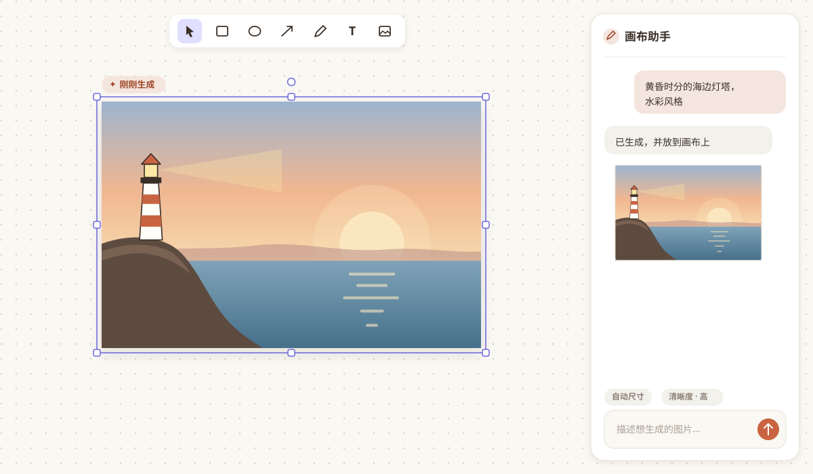
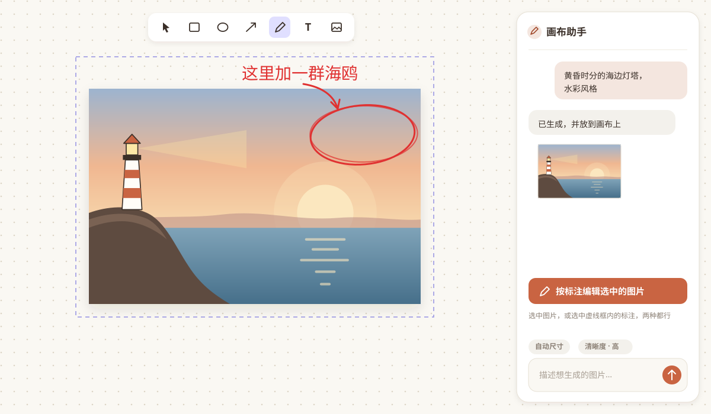

<h1 align="center">CanvasAnvil</h1>

<p align="center">
  <strong>AI-powered multi-canvas creation for diagrams, interior design, presentations and images.</strong>
</p>

<p align="center">
  
  
  
  
  
  
  
</p>

<p align="center">
  <a href="#creative-canvases">Canvases</a> |
  <a href="#ppt-canvas">PPT Showcase</a> |
  <a href="#video-tutorial">Video Tutorial</a> |
  <a href="#skills">Skills</a> |
  <a href="#quick-start">Quick Start</a> |
  <a href="#recent-updates">Recent Updates</a> |
  <a href="README.zh-CN.md">Chinese</a>
</p>

https://github.com/user-attachments/assets/582c70ae-38df-4949-913c-c3f4369a7c8c

<p align="center">
  <strong>⭐ If CanvasAnvil helps your workflow, please star the repo and fork it for your own canvas experiments.</strong>
</p>

> CanvasAnvil brings diagramming, interior design, presentation production and free-form image work into one workspace, in Chinese or English.

## 🔷 Diagram Canvas

Turn structured prompts into clear diagrams for research, systems, delivery plans, and teaching maps, then keep refining layout, labels, and node relationships in one place.

### Showcase

<table>
  <tr>
    <td width="50%" align="center"><br/><strong>Academic Research Framework</strong></td>
    <td width="50%" align="center"><br/><strong>Intelligent Q&A System Architecture</strong></td>
  </tr>
  <tr>
    <td width="50%" align="center"><br/><strong>Project Implementation Roadmap</strong></td>
    <td width="50%" align="center"><br/><strong>Course Design Mind Map</strong></td>
  </tr>
</table>

## 🏠 Interior Design Canvas

Describe the home you want, settle the plan with clickable decisions, and get an editable floorplan in a full house designer (2D, 3D, furniture, MEP, ceilings), checked and audited, with the quote, drawing set, DXF, colour plan and renders exported from it. You can also start from your own floorplan.

### Showcase

<table>
  <tr>
    <td colspan="2" align="center"><a href="public/examples/readme-previews/cad/split-view.png"></a><br/><strong>2D + 3D Split View</strong></td>
  </tr>
  <tr>
    <td width="50%" align="center"><a href="public/examples/readme-previews/cad/floorplan-furniture.png"></a><br/><strong>Editable Floorplan & Furniture</strong></td>
    <td width="50%" align="center"><a href="public/examples/readme-previews/cad/walkthrough.png"></a><br/><strong>3D Walkthrough</strong></td>
  </tr>
  <tr>
    <td width="50%" align="center"><a href="public/examples/readme-previews/cad/mep-routing.png"></a><br/><strong>MEP Layout & Routing</strong></td>
    <td width="50%" align="center"><a href="public/examples/readme-previews/cad/ceiling-lighting.png"></a><br/><strong>Ceiling & Lighting Plan</strong></td>
  </tr>
  <tr>
    <td width="50%" align="center"><a href="public/examples/readme-previews/cad/quantity-quote.png"></a><br/><strong>Quantity Takeoff & Quote</strong></td>
    <td width="50%" align="center"><a href="public/examples/readme-previews/cad/drawing-exports.png"></a><br/><strong>Construction Drawing Exports</strong></td>
  </tr>
</table>

<a id="ppt-canvas"></a>

## 📑 PPT Canvas

Generate full presentations through a controlled pipeline: outline first, visual production second, then export as PDF or image-based PPT. The deck template sets the style and colour palette; each slide gets a layout of its own.

### Showcase

<table>
  <tr>
    <td width="50%" align="center" valign="top">
      
      <strong>AI Content Creation Workflow</strong>
    </td>
    <td width="50%" align="center" valign="top">
      
      <strong>Intelligent Collaboration Growth</strong>
    </td>
  </tr>
  <tr>
    <td width="50%" align="center" valign="top">
      
      <strong>AI-Driven Business Innovation</strong>
    </td>
    <td width="50%" align="center" valign="top">
      
      <strong>Low-Carbon Smart Campus Transformation</strong>
    </td>
  </tr>
</table>

## 🖌️ Free Canvas

A whiteboard for images: describe a picture in one sentence and it lands on the board. Circle what to change, write a note beside it, press the wand, and a new version appears next to the original. Every version is kept, and the version strip shows what each one changed and when.

### Showcase

<table>
  <tr>
    <td width="50%" align="center"><br/><strong>An Image from One Sentence</strong></td>
    <td width="50%" align="center"><br/><strong>Mark It Up on the Board</strong></td>
  </tr>
  <tr>
    <td width="50%" align="center"><br/><strong>A New Version from the Marks</strong></td>
    <td width="50%" align="center"><br/><strong>Compare the Versions</strong></td>
  </tr>
</table>

<a id="creative-canvases"></a>

## 🎨 Creative Canvases

| Workspace | Focus | Typical output |
| --- | --- | --- |
| `Diagram` | structured diagram generation and partial editing | flowcharts, architecture diagrams, logic diagrams |
| `Interior Design` | interior planning, drawing coordination, and delivery packaging | concept boards, 2D drawings, render briefs, material lists |
| `PPT` | structured presentation generation and export | presentations, pitch decks, report slides |
| `Free Canvas` | text-to-image and edit-by-annotation on a whiteboard | posters, illustrations, revised versions of an image |

## 🌐 Online Access

Current online access URL:

- 🔗 CanvasAnvil: [https://canvasanvil.codingfgd.asia](https://canvasanvil.codingfgd.asia)

## Video Tutorial

One walkthrough per canvas on Bilibili (narrated in Chinese). In the app, the **Tutorials** button at the top of the home page plays them in place.

<table>
  <tr>
    <td width="50%" align="center"><a href="https://www.bilibili.com/video/BV1wyxs66EEd"></a><br/><strong>🔷 Diagram</strong> · <a href="https://www.bilibili.com/video/BV1wyxs66EEd">A whole architecture diagram from one sentence, and edits that touch only what you name</a></td>
    <td width="50%" align="center"><a href="https://www.bilibili.com/video/BV1ryxs6zEtN"></a><br/><strong>🏠 Interior Design</strong> · <a href="https://www.bilibili.com/video/BV1ryxs6zEtN">A full set of renovation drawings from one request, plus a 3D walkthrough</a></td>
  </tr>
  <tr>
    <td width="50%" align="center"><a href="https://www.bilibili.com/video/BV1oGxs6hEf6"></a><br/><strong>📑 PPT</strong> · <a href="https://www.bilibili.com/video/BV1oGxs6hEf6">An 8-slide deck from one sentence, with 200+ templates to choose from</a></td>
    <td width="50%" align="center"><a href="https://www.bilibili.com/video/BV17Gxs6aETm"></a><br/><strong>🖌️ Free Canvas</strong> · <a href="https://www.bilibili.com/video/BV17Gxs6aETm">Circle a spot and only that changes; the rest of the image stays put</a></td>
  </tr>
</table>

<a id="skills"></a>

## 🧰 Skills

CanvasAnvil includes dedicated local skills for each canvas so workflows stay opinionated, repeatable, and easier to maintain.

- `diagram-skill` · Diagram generation and packaging
  Opens the existing draw.io editor inside Codex. Chat-driven XML updates, manual edits and drawio/SVG/PNG exports synchronize through MCP. State lives under the project’s `diagram/` directory. The online draw.io editor requires network access.
- `cad-skill` · Interior-delivery workflow
  Opens the existing house designer inside Codex, with chat-driven designs, operations and spec patches, synchronized manual edits, checks and exports. State lives under `cad/`. The existing offline reconstruction and delivery scripts remain available.
- `ppt-skill` · Full presentation production
  The website's flow: a bundled template library, idea / outline / beautify modes, outline review with the user before anything is drawn, all slides drawn concurrently with retries, single-slide edits, and PDF, image PPTX or editable PPTX export. Prompts and templates are synced from the website with `node scripts/sync-ppt-skill.mjs`.
- `canvas-skill` · Image creation on a local whiteboard
  A native Codex canvas plugin reusing the website's Excalidraw board, annotation compositor, image placement and version strip. Give instructions directly in the Codex conversation. Codex captures selected images and annotations through MCP, then uses the host image tool and inserts results. Data lives in the project's `canvas/` directory.
  Install straight from GitHub, no clone needed:

  ```bash
  codex plugin marketplace add CodingFeng101/CanvasAnvil --ref main --sparse .agents/plugins --sparse skill/canvas-skill
  codex plugin add canvasanvil-canvas@canvasanvil
  ```

  For Claude Code (in a terminal):

  ```bash
  claude plugin marketplace add CodingFeng101/CanvasAnvil --sparse .claude-plugin skill/canvas-skill
  claude plugin install canvasanvil-canvas@canvasanvil
  ```

  `--sparse` makes the host download only the marketplace file and the plugin folder, not the whole repository.

  Then restart the host and invoke `$canvas-skill`, `$diagram-skill` or `$cad-skill` to open that canvas. `$ppt-skill` opens no editor: the assistant runs the deck flow itself (outline for your review, slides, export); fill `skills/ppt-skill/config/image-provider.json` in the installed plugin, or give its scripts a config path with `--config-file`. Node 20+ is required. The release includes the MCP and widget bundles with no runtime npm installation. If you installed earlier from the `canvasanvil-local` marketplace, add the marketplace again with the first command, since its name changed. You can also copy any `skill/<name>` folder into a project and use it on its own.

All skills use the host text model by default. Only image generation requires explicit provider configuration.
Editable PPTX export uses the host model too: the agent rebuilds the slides step by step following `skill/ppt-skill/references/editable-pptx-workflow.md`, with the scripts in the skill's `editable/` folder; its previews use PowerPoint on Windows and LibreOffice elsewhere, plus the Python packages in `editable/requirements.txt`.

<a id="quick-start"></a>

## 🚀 Quick Start

1. Install dependencies

```bash
npm install
```

The install also downloads draw.io (about 50 MB) into `public/drawio/`; the diagram canvas uses it first, so it opens offline. If the download fails the install still succeeds and the canvas uses the online draw.io; run `npm run drawio` to try again.

2. Start local development

```bash
npm run dev
```

Default URL: `http://127.0.0.1:8001`

CanvasAnvil deploys as a single service. See [deploy/README.md](deploy/README.md) for detailed deployment configuration.

3. Run type checks

```bash
npm run check
```

4. Build for production

```bash
npm run build
```

## 🧪 Common Commands

- `npm run dev`: start the app on `8001`
- `npm run check`: run TypeScript checks
- `npm run lint`: run ESLint
- `npm test`: run the test suite
- `npm run build`: build the production bundle

## 📝 Development Notes

- Every model call uses the OpenAI HTTP protocol. To use another vendor, point the base URL in Settings at their OpenAI-compatible endpoint — there is no provider list to pick from.
- AI configuration is read from local app settings; the text and image channels are configured separately.
- Local development depends on the API service for `/api/chat` and `/api/ppt-ai`.
- After changing local API route wiring in `vite.config.ts`, restart the dev server.
- `server/**` uses relative imports: `vite.config.ts` imports the dev middleware so `npm run dev` serves the API in-process, and Vite loads its own config through plain Node, which does not know the `@/` alias.
- Set `PROMPT_LOG_DIR` to write assembled prompts to disk; it is off by default because the log contains the user's content.

## 📚 Docs

- Architecture overview: [docs/architecture.md](docs/architecture.md)
- Deployment guide: [deploy/README.md](deploy/README.md)

<a id="recent-updates"></a>

## 🗓️ Recent updates

### 2026-11-20

**✨ New**

- **A new home page and a detail page for each canvas**: a long, quiet page in a warm, literary style, with real screenshots of each canvas and the prompts that made them. "Start creating" carries a prompt typed on the home page into the canvas.
- **Workspaces laid out like Claude**: a sidebar with New work, Search (`Ctrl K`), My works, the four canvases and recent works (pin, rename, delete). A new work opens on a greeting with three example cards, each a request this canvas really ran, shown with what it made; click one to send it.
- **Saved automatically**: every work is kept as you go, with no Save button. "New work" starts a fresh one and the old one stays in My works, so the clear-chat button and its setting are gone.
- **Built-in docs** (`#/docs`): 22 pages in Chinese and English covering getting started, each canvas, My works, Settings, skills, development, the FAQ and the changelog, plus a "How it works" group that explains the algorithms and why each was chosen (diagram layout correction, the generate-check-revise loop, the interior layout engine, the PPT pipeline, canvas edits, how works are stored). Search, an outline of the page, and copy buttons on code blocks.
- **More in Settings**:
  - **Usage stats**: a year heatmap; daily, monthly, hourly and weekday charts; generation time, models, images, works and tokens. Token counts are the provider's real usage, shown per turn and counted per canvas.
  - **Skills & plugins**: one-click install on localhost, `npx` and `git` commands, and zip downloads.
  - **Also new**: more completion chimes, storage used per canvas, and Memory (the global rules), Videos, Docs and About pages.
- **Claude Code plugin**: `.claude-plugin` manifests alongside the Codex ones, so the canvas skill installs in Claude Code too.

**⚡ Improvements**

- The interface language follows the browser on the first visit; the only switch is in Settings.
- Empty states, the sidebar and the About page read in a calmer voice, with small hand-drawn ornaments where they fit. Chinese is never set in slanted fake italics.
- Deep thinking shows file reading, reference images and the sketch as steps; the Interior Design 2D plan follows dark mode; the PPT canvas gets a slide rail and a slideshow.

**🐛 Fixes**

- PPT: the start screen shows again how it reads your input ("a topic" / "an outline" / "a file to restyle") and the chosen style, and the reading can be switched with one click.
- Clicking "No model set" under the input now opens Settings → Models on narrow windows too.
- "Start creating" on the home page no longer overshoots to the footer while images below are still loading.
- Docs headings with the same name (the changelog's "New" under each date) get their own anchors.

**📌 Notes**

- Removed: the old tutorials page (videos now live in Settings → Videos), the Save button and save dialogs, the clear-chat button and "Confirm before clearing".

### 2026-11-18

**✨ New**

- **My works: keep several works per canvas**
  - A new **My works** button in the header lists everything you have saved, with tabs for All / Diagram / Interior Design / PPT / Free Canvas. Open, rename, duplicate or delete; opening a work of another canvas switches to it.
  - Every canvas gets a **Save** button in the toolbar under its chat input. Name the work the first time and it appears in My works.
  - **Saved when you press Save**: what is on the canvas is still kept in the browser all the time, so a reload loses nothing, but the version in My works changes only when you press Save. After further edits the Save button shows a dot.
  - Leaving a work with unsaved changes asks Save / Don't save / Cancel; Don't save takes it back to the last saved version. A draft that was never saved is simply dropped.
  - Clearing the chat keeps a saved work in My works and opens a new blank one.
  - What you had before upgrading becomes your first work; the old data is left in place.

**⚡ Improvements**

- **The Diagram canvas keeps its chat and diagram in IndexedDB**, so long chats no longer fail to save when localStorage is full. Old data is copied over on first open and kept; replies being generated are saved every 3 seconds.
- **draw.io falls back to a mirror**: if the default address has not loaded in 8 seconds, the GitHub Pages mirror is used; if neither loads, a message with a Retry button appears. A draw.io address you configured yourself is used on its own.
- **No clone needed to install the plugin**: the README now adds the marketplace straight from GitHub (`codex plugin marketplace add CodingFeng101/CanvasAnvil`). The marketplace is renamed `canvasanvil`; if you added it as `canvasanvil-local`, add it again.

### 2026-11-13

**🐛 Fixes**

- **Diagram: "Drawing the diagram" kept spinning after the diagram was drawn, and edits failed**
  - After a dependency upgrade the AI SDK expects messages with `parts`; the diagram chat still sent the old format, so tool results never landed and the step stayed "running". That unanswered tool call then made the next request (an edit, for example) fail at the model API.
  - User messages use the new format; older chats are converted when opened, and steps stuck as running are closed, so they can be edited again.
- **Interior Design: picked decisions seemed to be ignored**
  - After you confirm the plan, its decisions show what you picked, along with the note you wrote under the options.
  - The floorplan request now lists your picks as the final decisions, and the model is told they override the rooms and must-have furniture the plan wrote for its own recommendation (central air conditioning means no wall units, for example).
- **Interior Design: `Designer unavailable` while generating, fixed only by generating again**
  - When a repair round reloaded the designer, the checks that followed still used the removed one. Every step now uses the current designer.
- **Interior Design: the floorplan step kept spinning after switching canvases or reloading**
  - Leaving the canvas stops the run, but the chat still showed it as running. It now shows as interrupted, with a button to generate again (your picks are kept).

**⚡ Improvements**

- The Interior Design canvas fills its area like the other canvases, with no margin or frame around it.
- The duplicate export buttons above the designer are gone; the quote, drawings, DXF, colour plan and renders come from the designer's own Quote and Export drawings at the top right.
- The README has its promo video back, and the links in its top navigation jump to their sections again.

## ⚖️ License

CanvasAnvil is released under the MIT License.
See [LICENSE](LICENSE) for the full license text.

## 💌 Contact

- `3524962421@qq.com`

## ⭐ Star History

[](https://star-history.com/#CodingFeng101/CanvasAnvil&Date)
